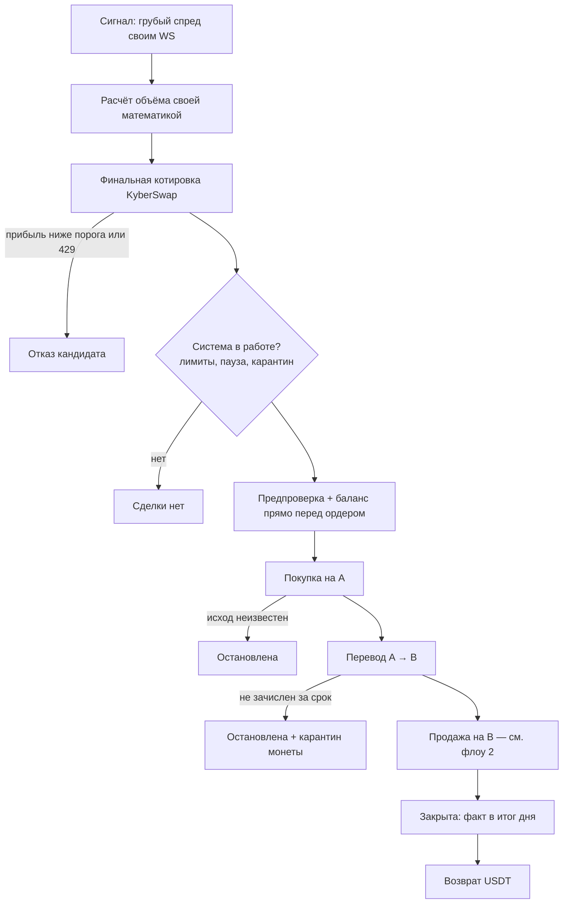
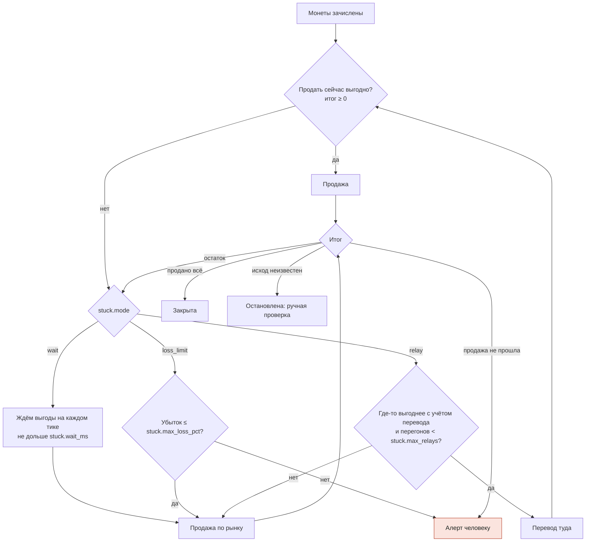
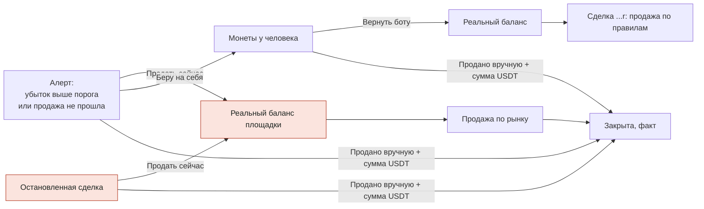
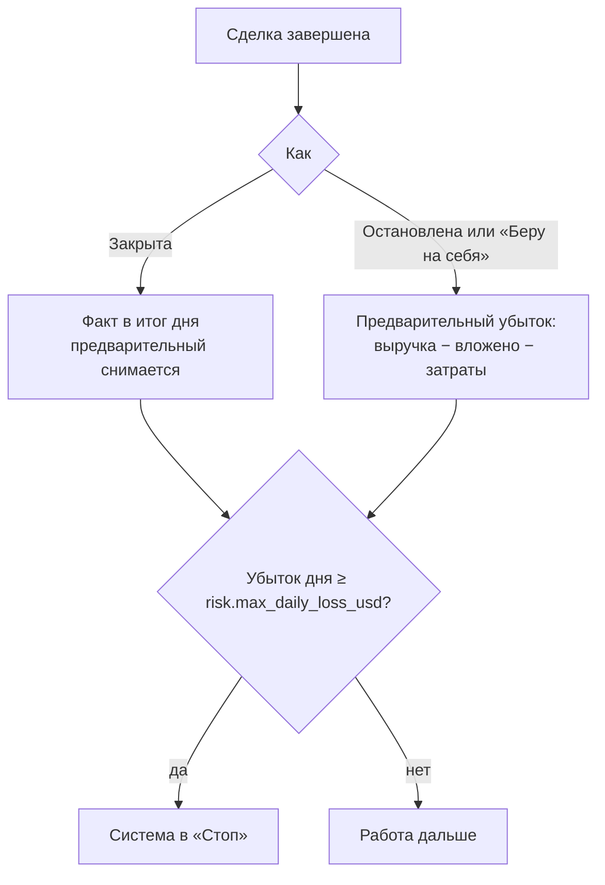

# Продажа, застрявшая монета и ручной разбор — флоу

Флоу по ТЗ (шаги 5–6, решения 37 и 53) против кода ядра. Составлено Claude 01.11.2026 (решения 99–101); живая версия — артефакт «ARB: продажа и ручной разбор».

## Что случилось со сделкой CAKE

- **21:21:35** — Свободно на BingX 44.19 USDT. Куплено 12.878 CAKE по 1.918 — вложено 24.70 USDT.
- **21:22:15** — На кошелёк зачислено 12.854122 CAKE (40 с в пути). Продавать в эту секунду невыгодно — режим «Порог убытка».
- **21:22:15** — Убыток не выше порога — продажа по рынку через KyberSwap.
- **21:22:18** — Продажа откатилась: «Return amount is not enough» (маршрут устарел после approve, исправлено решением 99).
- **21:22:18** — Сделка остановлена. В итог дня записан предварительный убыток −24.70 (монеты считаются потерянными до разбора).
- **21:22:18** — 24.70 > лимита risk.max_daily_loss_usd = 3 → система в «Стоп». Дальше на каждый сигнал: «сделки нет — система не в работе».
- **позже** — CAKE продан вручную, на кошелёк +24.44 USDT. Фактический итог ≈ −0.26 USDT плюс газ. Закрыть сделку этим фактом в интерфейсе было нечем.

По хронологии сделки 20261101182135312CAKE и журналу бота.

## 1. Сделка целиком

## 2. Продажа и застрявшая монета

Красным — что изменено решением 100. Раньше неудачная продажа сразу останавливала сделку.

## 3. Ручное управление

flowchart LR
  AL[Алерт:убыток выше порогаили продажа не прошла] -->|Продать сейчас| BAL[Реальный баланс площадки] --> MKT[Продажа по рынку] --> CL[Закрыта, факт]
  AL -->|Беру на себя| HO[Монеты у человека]
  AL -->|Продано вручную + сумма USDT| CL
  HO -->|Вернуть боту| BAL2[Реальный баланс] --> NEW[Сделка ...r: продажа по правилам]
  HO -->|Продано вручную + сумма USDT| CL
  HD[Остановленная сделка] -->|Продать сейчас| BAL
  HD -->|Продано вручную + сумма USDT| CL
  classDef new fill:#fbe4de,stroke:#b3361f,color:#1d2420
  class HD,BAL new

  Кнопки «Продать сейчас» и «Беру на себя» у алерта приходят и в Telegram. «Продано вручную» — только в интерфейсе: нужна сумма.

## 4. Итог дня и стоп

## ТЗ против кода

| Что по ТЗ | Что было в коде | Статус |
|---|---|---|
| Продажа на B; своп откатился — не повторять | Откат → сделка молча остановлена, монеты на месте, кнопок нет | исправлено: алерт человеку |
| Маршрут свопа свежий в момент отправки | После approve отправлялся устаревший маршрут — откат CAKE | решение 99, сборка 2e940af |
| «Порог убытка»: «Продать сейчас» / «Беру на себя» | Есть; «Продать сейчас» продавал количество из учёта, не проверяя баланс | теперь по реальному балансу |
| Остановленная сделка — ручная проверка | Видна только на «Сделках», действий нет; предварительный убыток висит до конца дня | «Продать сейчас», «Продано вручную» |
| Учёт — факт, а не план | Продажу человеком записать нельзя | «Продано вручную» с вводом USDT |
| «Ожидание» не дольше заданного, затем по рынку | stuck.wait_ms, затем рынок | соответствует |
| «Перегон» не больше N раз | stuck.max_relays, перевод туда, где выгоднее с учётом затрат | соответствует |
| Возврат капитала | В каждой сделке или по порогу (usdt_return.rs) | соответствует |
| Убыток за день выше лимита — остановка до ручного решения | «Старт» включает работу, даже если лимит уже превышен; стоп сработает только при следующем закрытии сделки | вопрос Тиграну |
